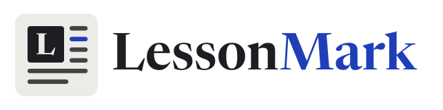
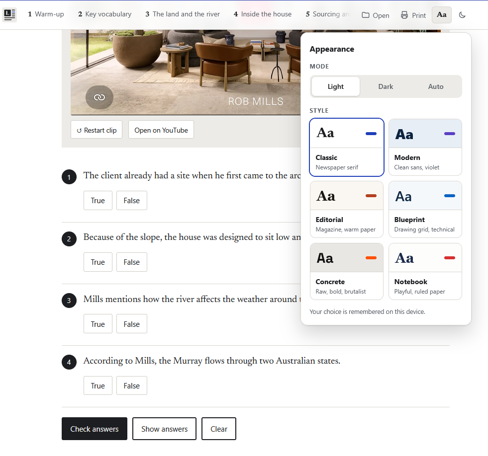

<p align="center">
  <a href="https://jeronimovis.github.io/lessonmark/">
    <picture>
      <source media="(prefers-color-scheme: dark)" srcset="assets/logo/dropcap-classic-dark.svg">
      
    </picture>
  </a>
</p>

<h3 align="center">Turn a video into an interactive English lesson.</h3>

<p align="center">
Pick a YouTube video or your own recording. A free AI writes the exercises,<br>
and LessonMark builds a page your students can use in class, at home or on their phones.
</p>

<p align="center">
  <a href="https://jeronimovis.github.io/lessonmark/"></a>
  <a href="https://jeronimovis.github.io/lessonmark/lessons/house-tour/"></a>
  <a href="https://github.com/jeronimovis/lessonmark/raw/main/assets/starter-kit.zip"></a>
</p>

<p align="center">
  <a href="https://jeronimovis.github.io/lessonmark/lessons/house-tour/">
    
  </a>
</p>

---

## Start here

1. **[Make a lesson from a YouTube video.](https://jeronimovis.github.io/lessonmark/#youtube)**
   Everything happens online, with free AI assistants. About 15 minutes.
2. **[Use your own audio or video.](https://jeronimovis.github.io/lessonmark/#own)**
   Download the starter kit, drop in your recordings and open the lesson.
3. **[See a finished lesson.](https://jeronimovis.github.io/lessonmark/lessons/house-tour/)**
   A 45-minute C1 lesson about a house on the Murray River.

The website takes you through each path step by step, with pictures.

## What your students get

- **Clips that start and stop where you choose**, from YouTube, MP3 or MP4.
- **Fifteen kinds of activity** that check themselves: gaps, true or false, multiple choice, matching, ordering, word formation and more.
- **Help when they're stuck**: a word bank to open, and an answer key at the end.
- **Reading texts, images, timers**, useful-language boxes and role cards.
- **Six looks**, light and dark, on phones, projectors and paper.

And for you: teacher's notes, folded away at the bottom of the page.

## A lesson is a text file

This is part of the starter kit's demo lesson. Change a word, save, reload, and the page changes with it.

```
## Watch | Individual · 4 minutes
> Watch the video. Are the sentences true or false?

[play video.mp4 "The video"]

[tf] You can use your own audio and video files instead of these ones. [t]
[tf] YouTube videos play well when you open the lesson from your computer. [f]
```

Teachers write lessons by hand in Notepad or TextEdit, or ask an AI to write them with the prompts in [`ai/`](ai/).

## Examples

- **[House tour](https://jeronimovis.github.io/lessonmark/lessons/house-tour/)**: a complete C1 lesson for architects, made from a YouTube house tour.
- **[Feature guide](https://jeronimovis.github.io/lessonmark/lessons/feature-guide/)**: a lesson about the engineering of Venice that shows every activity, with how each one is written.

## Downloads

- **[Starter kit](https://github.com/jeronimovis/lessonmark/raw/main/assets/starter-kit.zip)**: the page, a demo lesson, a short audio and video, and the AI files.
- **[AI files](ai/)**: the three prompts and `SKILL.md`, which teaches any AI assistant the LessonMark format.

## For the curious

- **[Reference](https://jeronimovis.github.io/lessonmark/assets/LessonMark-reference.html)**: every tag and option, with examples to copy.
- **[Specification](assets/LessonMark-spec.md)**: the complete notation, written for AI assistants.
- **How it works**: one HTML file reads the lesson text and builds the page inside the browser. It works on any static host, or straight from a folder on your computer. The only outside resources are Google Fonts and, for YouTube clips, the YouTube player.

```
lessonmark/
├── index.html      the website
├── online/         LessonMark online: paste or open any lesson
├── lessons/        house-tour/ and feature-guide/
├── starter-kit/    the files inside starter-kit.zip
├── ai/             prompts and SKILL.md
└── assets/         logo, screenshots, starter-kit.zip, reference, specification
```

## Licence

[MIT](LICENSE). Free to use, change and share.

Made by [Jerónimo Visñovezky](https://jeronimov.org), English teacher.
